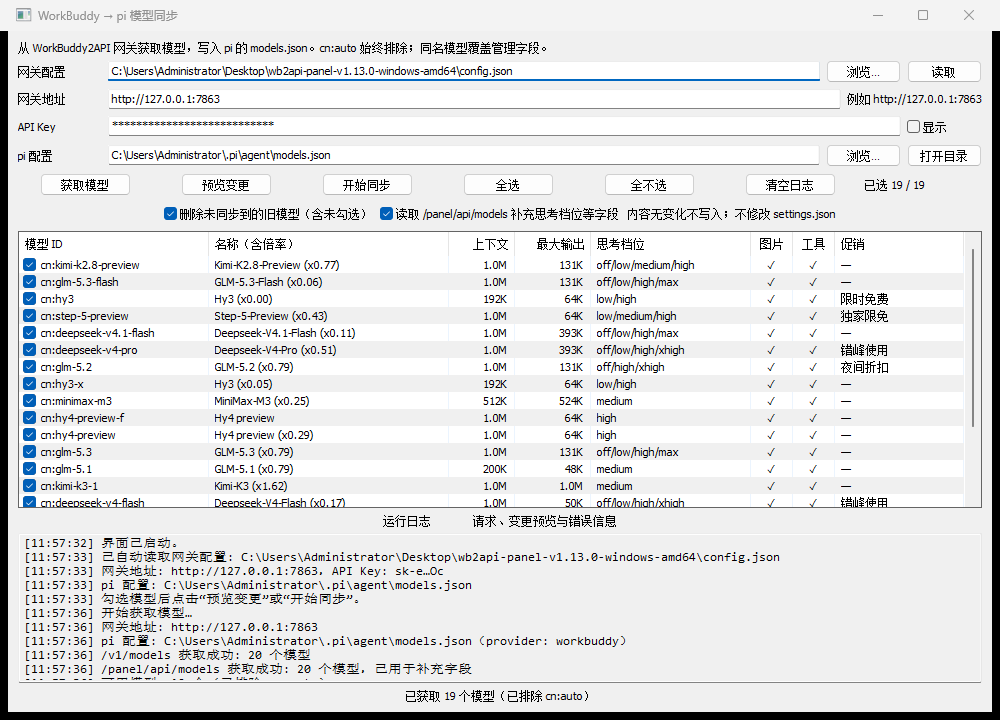

# wb2pi-model-sync

把 **WorkBuddy2API** 网关的模型列表同步到 **pi** 的 `models.json` 的 Windows 小工具（Go + 原生 GUI）。



## 功能

- 从网关 `GET /v1/models` 获取全部模型；再用 `GET /panel/api/models` 补充
  `can_disable_thinking`、`supported_efforts`、`default_effort`、`is_default`、促销信息。
- **始终排除 `cn:auto`**。
- 写入 pi 配置（默认 `~/.pi/agent/models.json`）的 `providers.workbuddy.models`。
- 同名模型覆盖这些“管理字段”，其余自定义字段原样保留：
  `id` / `name` / `reasoning` / `input` / `contextWindow` / `maxTokens` / `cost` / `thinkingLevelMap`。
- **默认删除未同步到的旧模型**（GUI 可取消勾选；CLI 用 `--keep-missing` 保留）。
- 模型名后附加倍率提示，例如 `Deepseek-V4.1-Flash (x0.11)`；无倍率则不加。
- `maxTokens` **照抄上游** `max_output_tokens`，不做上限裁剪。
- 思考档位按上游 `supported_efforts` 生成：
  - `off` 仅在 `can_disable_thinking=true` 时映射为 `"none"`，否则为 `null`；
  - 其他档位在支持列表里则直传，否则为 `null`。
- 临时文件 + 原子替换；内容无变化时不会写文件；**不生成备份文件**。
- **不修改** `settings.json`（不会改默认模型/思考档）。
- 其他 provider 原样保留。

## 快速开始

1. 双击 `wb2pi-model-sync.exe`。
2. 程序会自动发现 `Desktop\wb2api-panel-*\config.json` 并读取 `listen` / `api_key`；
   也可以手动点击「浏览…」选择。
3. 点击「获取模型」→ 表格默认全选 → 可取消勾选 → 「预览变更」→「开始同步」。
4. 重启 pi，或在 pi 里重新打开 `/model` 让配置重新加载。

默认路径：

| 项目 | 默认值 |
|---|---|
| 网关地址 | `http://127.0.0.1:7863` |
| 网关配置 | 自动搜索 `Desktop\wb2api-panel-*\config.json` |
| pi 配置 | `C:\Users\<用户>\.pi\agent\models.json` |
| provider | `workbuddy` |

本工具**不生成备份文件**。如需保留旧版本，请在同步前自行复制 `models.json`。

## 命令行模式

`wb2pi-model-sync-cli.exe` 是控制台版本，适合脚本/计划任务：

```bat
:: 预览，不写文件
wb2pi-model-sync-cli.exe --cli --config "C:\...\wb2api-panel-v1.13.0-windows-amd64\config.json" --dry-run

:: 正式同步
wb2pi-model-sync-cli.exe --cli --config "C:\...\config.json"

:: 只同步指定模型（注意：默认仍会删除未列出的旧模型）
wb2pi-model-sync-cli.exe --cli --config "C:\...\config.json" --only cn:deepseek-v4.1-flash --keep-missing

:: 不读取 /panel/api/models
wb2pi-model-sync-cli.exe --cli --config "C:\...\config.json" --no-panel
```

| 参数 | 说明 |
|---|---|
| `--cli` | 进入命令行模式（GUI exe 没有控制台，请用 `-cli.exe`） |
| `--config` | 网关 `config.json` 路径 |
| `--base-url` | 网关地址，覆盖 config 中的 `listen` |
| `--api-key` | 网关 API Key，覆盖 config 中的 `api_key` |
| `--models-file` | pi `models.json` 路径 |
| `--provider` | pi provider 名称，默认 `workbuddy` |
| `--dry-run` | 只打印变更，不写文件 |
| `--keep-missing` | 保留未同步到的旧模型 |
| `--no-panel` | 不读取 `/panel/api/models` |
| `--only` | 逗号分隔的模型 ID，仅同步这些模型 |
| `--version` | 显示版本 |

`--only` 与默认删除策略同时使用会删除未列出的旧模型；只更新指定模型请加 `--keep-missing`。

## 字段映射

| pi 字段 | 来源 | 说明 |
|---|---|---|
| `id` | `id` | 保留 `cn:` 前缀 |
| `name` | `name` + `credits` | 追加 `(x0.11)` 形式的倍率 |
| `reasoning` | `supports_reasoning` | 直接映射 |
| `input` | `supports_images` | `["text"]`，支持图片则加 `"image"` |
| `contextWindow` | `context_length` | 缺失时跳过该模型并记录警告 |
| `maxTokens` | `max_output_tokens` | 缺失时回退 `min(context, 32768)` |
| `cost` | 无 | 全部为 0（credits 不是 USD，避免误导） |
| `thinkingLevelMap` | `supported_efforts` + `can_disable_thinking` | 见上 |
| provider `compat` | 固定 | `supportsReasoningEffort: true`、`maxTokensField: "max_tokens"` |

## 构建

需要 Go（开发时使用 `go1.27.2 windows/amd64`）和 `rsrc`（用于嵌入 manifest/图标）。

```powershell
# 在项目目录
$env:GOPROXY = "https://goproxy.cn,direct"
go install github.com/akavel/rsrc@latest
& "$(go env GOPATH)\bin\rsrc.exe" -manifest app.manifest -ico app.ico -o rsrc.syso

go build -ldflags="-H windowsgui -s -w" -o wb2pi-model-sync.exe .
go build -ldflags="-s -w" -o wb2pi-model-sync-cli.exe .
```

或直接运行：

```powershell
.\build.ps1
```

## 测试

```powershell
go test ./...
```

测试使用 `testdata/v1_models.json` 和 `testdata/panel_models.json` 作为离线样例。

## 目录

```
app.ico                 程序/窗口图标（由 tools/make_icon.py 生成）
app.manifest            Windows manifest（Common Controls 6 + DPI）
rsrc.syso               嵌入的 manifest/图标资源
main.go                 GUI / CLI 入口
ui.go                   walk 原生 GUI
gateway.go              /v1/models 与 /panel/api/models 请求
models.go               字段合并、思考档位、倍率名称
piconfig.go             models.json 读取、合并、原子写入
app.go                  请求解析与同步编排
*_test.go               单元测试
testdata/               离线模型样例
tools/make_icon.py      生成 app.ico
```

## 已知限制

- 仅支持 Windows（GUI 使用 `github.com/lxn/walk`）。
- `/v1/models` 在网关侧缓存 1 小时；需要最新列表/促销信息时以 `/panel/api/models` 为准。
- `max_output_tokens` 可能是上游声称值，实际可能被静默钳制；工具按你的要求照抄。
- 模型顺序跟随网关返回顺序；同名模型不会重命名。
- `cost` 为 0，pi 底部显示的成本为 $0；真实 credits 消耗看网关面板/日志。
- 不修改 `settings.json`，默认模型/思考档需要你在 pi 里自行选择。

## 安全

- 工具只请求你填写的本地/私有网关，不向第三方发送任何数据。
- API Key 只用于请求头；日志中只显示掩码。
- 本工具**不生成备份文件**；重要配置请在同步前自行复制。
- `models.json` 中仍保存明文 API Key（pi 本身的要求），请勿把配置或 `auths/` 目录外传。
